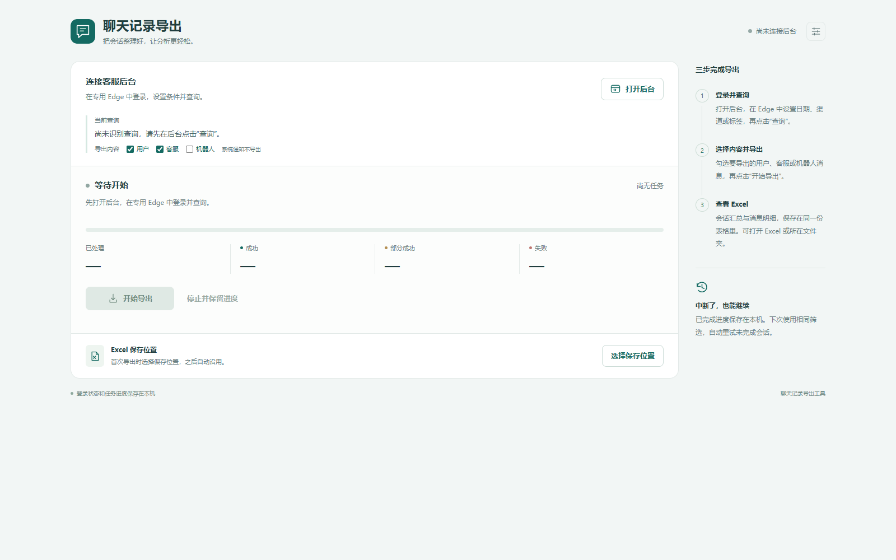

# 合力CRM聊天详情爬虫

将合力 CRM「会话记录高级查询」中的会话详情导出为 Excel。提供中文桌面界面，支持断点恢复、停止后继续和消息完整性检查。

基于 TypeScript、Playwright、Electron 和 ExcelJS 开发。通过专用 Microsoft Edge 人工登录，复用当前账号已有的查询权限。本项目为第三方工具，与合力 CRM 官方无隶属关系。

**[下载 Windows 免安装版](https://github.com/suosijieniwo/holly-crm-chat-detail-crawler/releases/latest) · [使用说明](docs/user-guide-zh-CN.md) · [MIT License](LICENSE)**



## 功能

- **按后台筛选导出**：在网页设置日期、渠道、标签、坐席等条件并查询，再从桌面窗口开始导出。
- **只保留访客与人工客服**：排除机器人与系统通知，保留文字和图片、语音、视频、附件的链接。
- **两张工作表**：生成「会话汇总」和「消息明细」，用于质检、分析与归档。
- **进度可见**：展示已处理、成功、部分成功与失败数量，同一窗口支持连续导出。
- **停止与恢复**：停止时等待在途操作收尾；相同筛选再次执行时复用断点，重试未完成会话。
- **完整性检查**：缺少媒体链接、发送方无法识别或无法确认完整历史时标记部分成功，不会仅凭 Excel 已生成就报告全部成功。
- **独立登录环境**：登录状态和任务断点保存在本机，不读取日常 Edge 的默认用户配置。

## 直接使用 exe

从 [Releases](https://github.com/suosijieniwo/holly-crm-chat-detail-crawler/releases/latest) 下载 `Holly-CRM-Chat-Exporter-v1.0.0.exe`，双击即可。软件界面仍显示中文名称「客服聊天记录导出工具」。

| 项目 | 要求 |
| --- | --- |
| 系统 | Windows x64；当前已在 Windows 11 验证 |
| 浏览器 | 已安装 Microsoft Edge |
| 后台 | 可以访问受支持站点，并拥有会话查询权限的账号 |
| Node.js / npm | **不需要安装**，exe 自带运行环境 |

1. 点击工具中的 **打开后台**。
2. 在专用 Edge 中手动登录，进入「会话记录高级查询」。
3. 设置筛选条件，点击后台原有的 **查询**。
4. 回到桌面窗口，确认当前查询，点击 **开始导出**。导出期间保持后台开启。
5. 完成后点击 **打开 Excel** 或 **打开文件夹**。

导出前至少设置一个有效筛选条件。默认输出到 Windows 实际桌面的 `客服聊天记录导出` 文件夹。不要同时运行旧批处理工具与桌面版，以免争用同一个专用 Edge 登录目录。

## 导出内容与恢复规则

| 工作表 | 内容 |
| --- | --- |
| 会话汇总 | 会话与访客标识、时间、坐席、渠道、标签、实际保留的消息数量、导出状态等 |
| 消息明细 | 访客和人工客服消息的时间、发送方、类型、文本、媒体链接等 |

图片、语音、视频与附件只保存接口返回的链接，不下载文件实体。超长文本分段写入，汇总消息数仍按原消息计数；网页文本按 Excel 纯文本写入。

- **成功**：会话采集通过完整性检查。只有所有会话成功且 Excel 回读校验通过，才清理该任务断点。
- **部分成功 / 失败**：生成可用结果并保留断点，再次使用相同筛选时重试。
- **手动停止**：等待在途操作完成保存后显示已停止；停止不等于已生成最终 Excel。
- **恢复任务**：沿用断点中冻结的会话列表。希望重新采集当前筛选的最新全集时，先清除旧的未完成任务。

设置中的「清除任务」和「清除登录」分别确认，不删除已导出的 Excel。清除登录前需关闭专用 Edge 并等待其退出。

## 适配范围

当前代码与站点契约针对 `a8.7x24cc.com` 的「会话记录高级查询」页面，只允许工具主动调用以下同源只读动作：

```text
POST /action
app.media.queryChatRecord    # 会话列表
app.media.getSessionRecord   # 会话消息详情
```

工具不会主动修改标签、备注、状态或工单，也不会发送消息。该白名单约束工具自身的采集请求，不替代后台原有的登录与权限控制。

其他部署域名、页面或接口版本可能需要修改站点契约、域名约束和相关测试。目前没有宣称支持所有合力 CRM 部署或全部渠道。请仅在获得授权的账号与数据范围内使用，不提供绕过登录或权限的功能。

## 开发与源码运行

开发需要 **Node.js 24 或更高版本**、npm、Windows 和 Microsoft Edge；直接使用 exe 的用户无需安装这些开发工具。

```powershell
git clone https://github.com/suosijieniwo/holly-crm-chat-detail-crawler.git
cd holly-crm-chat-detail-crawler
npm ci
```

Electron 44 的运行文件按需下载。首次运行或打包前，可以显式准备项目锁定版本的运行环境：

```powershell
npx --no-install install-electron
```

启动桌面界面：

```powershell
npm run desktop
```

原批处理入口继续保留。源码构建完成后可双击 `启动聊天记录导出工具.bat`，或执行：

```powershell
npm run build
npm start
```

| 命令 | 用途 |
| --- | --- |
| `npm test` | 运行测试；桌面 UI 测试需要本机 Edge |
| `npm run build` | 编译 TypeScript |
| `npm run desktop` | 构建并启动桌面版 |
| `npm run package:portable` | 构建 Windows x64 单文件免安装 exe |
| `node scripts/generate-example.mjs` | 构建后生成完全虚构的 Excel 格式示例 |

## 打包

在 Windows x64 开发环境中执行：

```powershell
npm ci
npx --no-install install-electron
npm run package:portable
```

产物位于 `release/客服聊天记录导出工具.exe`。构建使用 Electron 自带运行环境，不依赖最终用户电脑上的 Node.js。二进制文件通过 GitHub Releases 分发，不提交到源码仓库。

## 目录结构

```text
config/                站点契约与字段映射
desktop/               Electron 入口、预加载脚本与中文界面
src/browser/           Edge 启动、查询观察、只读接口请求
src/desktop/           桌面任务控制器与运行时
src/query/             会话列表采集与筛选快照
src/messages/          消息采集与标准化
src/jobs/              限速、任务调度、断点与恢复
src/export/            Excel 写出与回读校验
src/security/          同源只读请求白名单
tests/                 单元、集成与界面测试
scripts/               启动、打包、清理与示例生成
examples/              完全虚构的 Excel 格式示例
```

测试夹具中的会话内容、身份和媒体地址已替换为占位值，不能作为真实业务记录使用。仓库不包含登录资料、生产聊天导出、任务断点和内部验收记录。

## 本机数据位置

| 数据 | 位置 |
| --- | --- |
| 专用登录环境 | `%LOCALAPPDATA%\CustomerChatExporter\edge-profile` |
| 未完成任务 | `%LOCALAPPDATA%\CustomerChatExporter\jobs` |
| 桌面版导出文件 | Windows 实际桌面下的 `客服聊天记录导出` |

原批处理入口使用 `%USERPROFILE%\Desktop\客服聊天记录导出`；桌面被 OneDrive 或组织策略重定向时，两种入口的输出目录可能不同。

登录目录、任务断点和导出的 Excel 可能包含敏感数据，不应上传到公开仓库。`.gitignore` 已排除这些运行数据、构建目录和内部记录。

## 已验证与限制

- 2026-10-19：23 个测试文件、91 项测试及 TypeScript 构建通过。
- 最终 portable exe 从包含中文和空格的路径运行，在仅保留 Windows 系统路径的进程环境中验证了窗口、导出、停止恢复与单实例行为。
- 虚构数据验证覆盖 2 条会话、4 条消息和 Excel 回读。
- 经授权的真实小样本验证覆盖当天 1 条会话、4 条消息，结果为成功；不会公开该样本。
- 上述结果不等同于在一台从未安装 Node.js 的干净电脑上实测，也不代表同事电脑、所有 Windows 版本、所有渠道或超大批量数据均已验收。
- v1.0.0 免安装文件未配置商业数字签名。

报告问题时请提供错误提示和复现步骤，并移除聊天正文、访客标识、登录令牌及其他业务信息。

## 许可证

本项目采用 [MIT License](LICENSE)。第三方依赖遵循各自的许可证。
